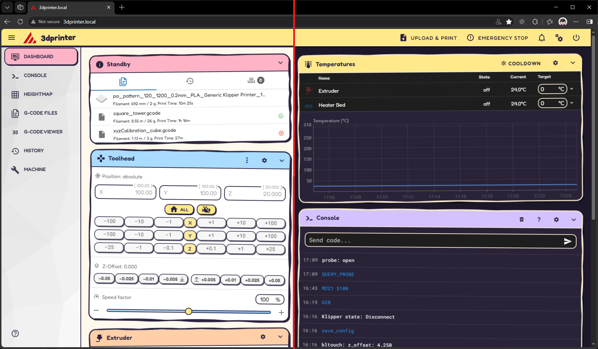
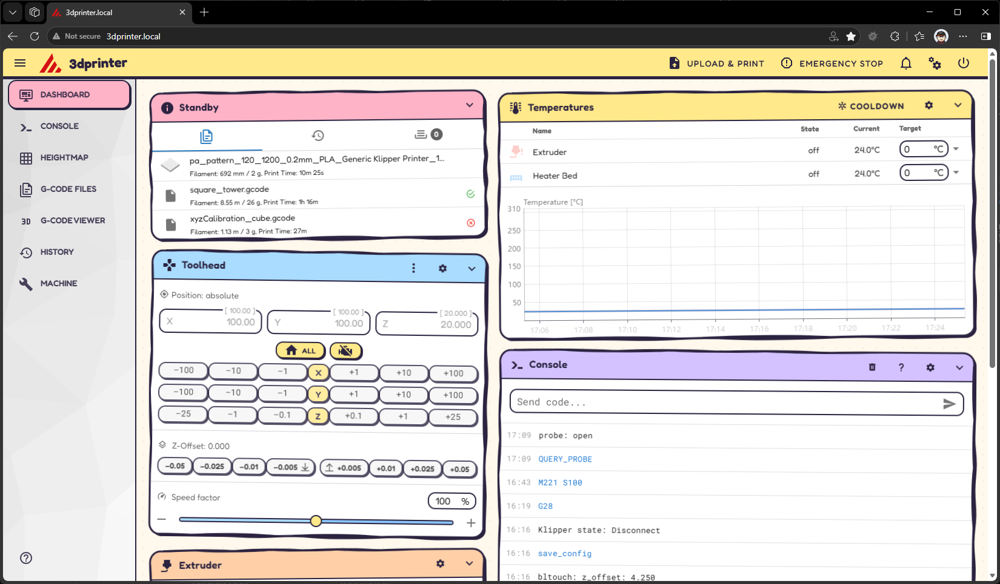
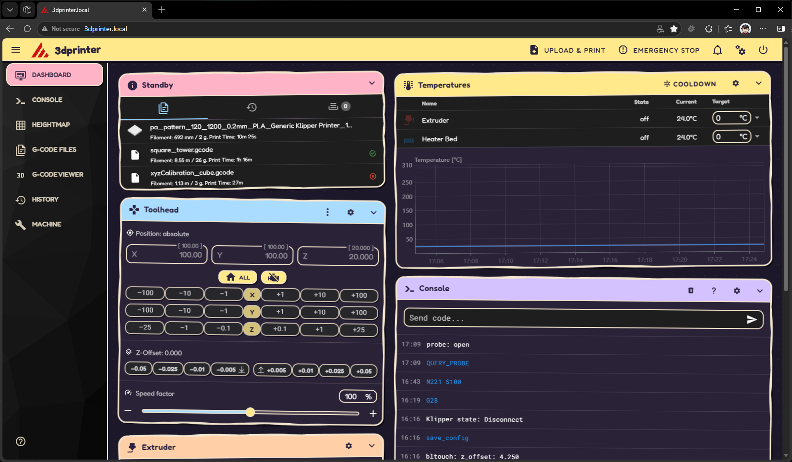

# Sticker Book — a cartoony theme for Mainsail

A light-hearted theme for [Mainsail](https://docs.mainsail.xyz/): pastel panels that look like stickers slapped on a page, hand-drawn wobbly outlines, chunky hard shadows, squishy buttons and a friendly rounded font. Works in both **light** and **dark** mode.



## Features

- **Hand-drawn outlines** — every panel has a slightly wobbly ink outline with a matching wobbly hard shadow
- **Slightly askew** — panels sit at a small tilt and spring level when you hover over or use them
- **Sticker colours** — each dashboard panel gets its own pastel header (pink, sky, peach, butter, lilac, mint)
- **Light and dark** — cream paper with ink outlines, or a plum night with chalk outlines; follows Mainsail's Mode setting
- **Squishy buttons** — chunky outlined buttons that press down when clicked
- **Offline-friendly** — the [Fredoka](https://github.com/hafontia/Fredoka-One) font ships with the theme, no Google Fonts requests

## Screenshots

| Light | Dark |
|---|---|
| [](light.png) | [](dark.png) |

## Installation

### With git (recommended)

SSH into your printer and clone the theme into Mainsail's theme folder:

```sh
git clone https://github.com/philrennie/mainsail-cartoon-theme ~/printer_data/config/.theme
```

> If you already have a `.theme` folder, move it out of the way first (for example `mv ~/printer_data/config/.theme ~/printer_data/config/.theme.bak`) — git won't clone into a folder that isn't empty.

Then reload Mainsail with a hard refresh (**Ctrl+Shift+F5**, or **Cmd+Shift+R** on macOS).

### Without git

1. Download this repository as a ZIP and unzip it.
2. In Mainsail, open the **Machine** page. In the file manager's cog menu, turn on **Show Hidden Files**.
3. Create a folder called `.theme` (if there isn't one already) and upload these three files into it:
   - `custom.css`
   - `fredoka.woff2`
   - `fredoka-OFL.txt`
4. Hard refresh the browser (**Ctrl+Shift+F5** / **Cmd+Shift+R**).

`custom.css` loads the font by a relative path, so `fredoka.woff2` must sit in the same folder.

### Light or dark

Pick either under **Settings → UI-Settings → Mode** — the theme adapts automatically. The **Primary** colour setting is mostly overridden by the theme's pastels; the **Logo** colour still tints the Mainsail logo in the top bar, so pick whatever looks good against the butter-yellow bar (a dark ink such as `43, 35, 64` works well).

## Updating

If you installed with git, you can let Moonraker keep the theme up to date. Add this to `moonraker.conf`:

```ini
[update_manager mainsail-sticker-book]
type: git_repo
channel: dev
path: ~/printer_data/config/.theme
origin: https://github.com/philrennie/mainsail-cartoon-theme
primary_branch: main
```

Restart Moonraker, and the theme will appear in Mainsail's update manager alongside Klipper and Moonraker.

> Moonraker refuses to update a repo with local changes. If you want to tweak the theme, fork it and point `origin` at your fork rather than editing the installed copy.

Without git, just re-upload the three files.

## Customising

All colours are CSS variables near the top of `custom.css`:

- **`.v-application`** — the shared pastels (`--pink`, `--sky`, `--butter`, …) and `--on-pastel` (text on pastel headers and buttons)
- **`.v-application.theme--light`** — light mode: `--paper`, `--card`, `--text`, `--outline`, `--shadow`, …
- **`.v-application.theme--dark`** — the same set for dark mode

Each dashboard panel's header colour and tilt are set per panel:

```css
.v-application .panel.temperature-panel { --panel-colour: var(--butter); --tilt: -0.4deg; }
```

Some common tweaks:

| To… | Do this |
|---|---|
| Change a panel's colour | Edit its `--panel-colour` line |
| Turn off the tilt | Add `.v-application .panel.v-card { --tilt: 0deg !important; }` at the end of the file |
| Colour a panel that isn't listed | Add a line using the panel's class, e.g. `.v-application .panel.webcam-panel { … }` — inspect the panel to find its `*-panel` class |

### Changing the outline colours

The wobbly outlines are SVG images stored in the `--sq-fill`, `--sq-line`, `--sq-fill-flat` and `--sq-line-flat` variables, and their colours are baked into the images. If you change `--outline`, `--shadow` or `--card`, regenerate them with the included script (Python 3, no dependencies):

```sh
python3 tools/squiggle.py --outline "#2b2340" --shadow "#2b2340" --card "#ffffff"
```

It prints four replacement lines to paste over the existing `--sq-*` lines in the matching mode block. Add `--svg some-folder` to also write the images out so you can preview them.

## How it works

- **Outlines:** each panel gets a `::before` (the wobbly fill plus the same shape offset 4px for the hard shadow, drawn behind the contents) and an `::after` (the wobbly outline, drawn on top). Both are 9-slice `border-image`s, so the wobble stretches to fit any panel size without distorting the text or controls inside.
- **Tilt:** panels are rotated with `transform` and use `will-change: transform`, so the browser draws them flat first and then rotates the result. Without it, hairline seams can show between the 9-slice pieces.
- **Light/dark:** Mainsail (Vuetify 2) puts `theme--light` or `theme--dark` on the app root, and each mode defines its own set of variables there.

## Compatibility

- Built for Mainsail's current Vuetify 2–based interface.
- Works in current Chrome, Edge, Firefox and Safari. A few small touches (straight sides on collapsed panels, the settings dialog fix) use the CSS `:has()` selector (Chrome/Edge 105+, Firefox 121+, Safari 15.4+); older browsers just skip them. The custom scrollbars only show in Chromium-based browsers and Safari.
- Text in a tilted panel can look very slightly softer than usual on some screens; it goes crisp when the panel straightens on hover. If that bothers you, turn off the tilt (see above).

## Credits and licence

- Theme: MIT licence — see [LICENSE](LICENSE).
- Font: [Fredoka](https://github.com/hafontia/Fredoka-One) by The Fredoka Project Authors, via [Fontsource](https://fontsource.org/fonts/fredoka) (`@fontsource-variable/fredoka` 5.3.0, Latin subset). Licensed under the SIL Open Font License 1.1 — see [fredoka-OFL.txt](fredoka-OFL.txt).
- Dark/light variable structure inspired by [mainsail-printables](https://github.com/8bitmcu/mainsail-printables).
